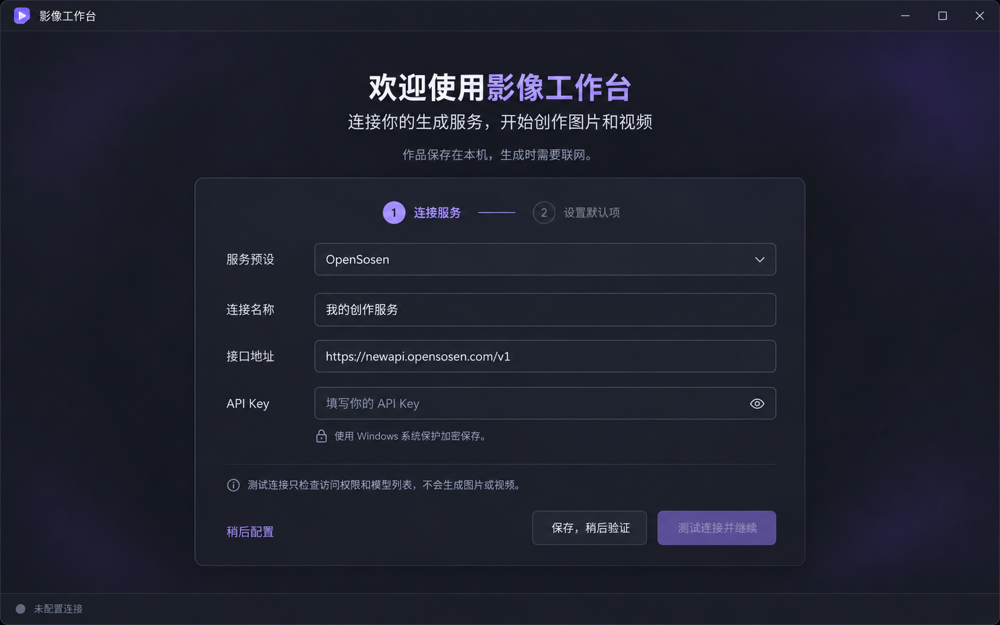

# 视频工作台功能规划、实现拆解与技术方案

> 2026-10-26 当前下载体验：D01–D03 已主审；D04–D10 已实现并完成离线验收，源码与离线范围主审通过。图片下载默认30秒、视频180秒可配置；生成与下载独立预算，原卡片/详情显示进度并可重新下载。用户选择保持原来源存储，不新增加密；无ID临时链接重启后不可恢复时明确提示。见[实施记录](implementation/D04-D10-下载恢复与工作台体验.md)。未提交、打包或发布，已发布3.6.5仍执行旧规则。

版本：v1.2（确认 Nova 定制方向与实施依赖）  
日期：2026-10-23  
目标平台：Windows 10/11 x64  
工作名称：影像工作台（包含生图和生视频，最终名称可调整）  
原始阶段说明（2026-10-23）：功能与技术规划。2026-10-24 当前状态：B5 离线范围已接受；T15 暂停，用户批准 T16 独立离线准备，当前只交付本地离线测试版。61 项原需求继续有效，未宣布最终全功能完成。

实施底座补充（2026-10-23）：已克隆 Nova Studio 至 `E:\Learn\AI\nova-image-studio`，完成源码静态分析。具体改造见 [Nova Studio 改造分析与实施拆解](./Nova-Studio改造分析与实施拆解.md)。采用该底座时保留其 Next.js + React + Tailwind + Electron + Node CommonJS + SQLite + npm 技术栈，替代本文第 5 节从零搭建的 Vite/CSS Modules/pnpm 建议；本文件的 61 项产品功能与验收要求继续有效。当前未安装依赖、运行应用或调用付费生成。

## 1. 要交付什么

### 产品方向确认（2026-10-23）

基于 Nova 定制本地图片/视频工作台，不采用“原版所有功能保持不变，只增加一个插件”的方式。首版聚焦图片生成、视频生成、作品库、设置四个入口，继续按本文 61 项功能验收。复用 Nova 技术基础，改造任务恢复、凭据和永久存储，重组界面以符合已确认设计。

Nova 额外能力作为后续候选：提示词收藏、素材标签/备注/去重、结果比较、多供应商管理界面、插件管理界面、用户备份恢复、提示词优化/反推、无限画布和 GIF。本轮不扩充首版验收范围，后续有需要再接入。已有的底层多连接数据结构、插件适配机制、升级前数据库备份仍属于核心实施需要；它们不等于开放完整高级工具。公共提示词广场、Agent/浏览器自动化、UI 切图等首版关闭入口及不必要的后台能力，暂不大规模删除源码。

实施任务及依赖以 [Nova Studio 落地任务清单](./Nova-Studio落地任务清单.md) 为准。当前会话负责分析、指导和验收；后续实施交给指定 `gpt-6.1-sol` / `xhigh` 子代理，本轮只形成任务清单，未启动实施。

交付一个可以在本机安装、独立启动的桌面应用，完成以下流程：

> 配置中转 → 选择图片或视频 → 输入提示词与参考图片 → 提交生成 → 查看状态 → 预览与自动保存 → 从历史记录复用。

本地负责界面、参数校验、任务调度、素材管理、历史记录、播放和文件保存。图片与视频由配置的远端 API 生成，需要联网；不要求安装本地生成模型，也不依赖 DSH。

本方案以已经生成的两张界面设计图为功能基线。图片里的控件都需要有对应操作、状态和验收条件，不能仅实现静态页面或模拟成功结果。

### 1.1 设计图的定位

- 图片页：左侧导航，中间填写生成参数，右侧查看图片，下方浏览最近结果。
- 视频页：左侧导航，中间选择生成模式、模型、参考图片和剧情，右侧播放视频，下方查看最近任务。
- 两页共用连接设置、素材管理、任务系统和作品库。
- 设计图中的图片、视频画面、进度和完成状态均是示意素材，开发时不能将其作为实际生成结果。
- 图片页的 `44/2000` 不代表供应商声明的提示词上限。实现时默认显示实际字数；只有配置了明确的应用限制，才显示分母并说明来源。
- 视频页虽然画有时长下拉框，但当前固定六秒模型应显示锁定的“6 秒”，不能提供无效选项。

首次启动、未配置、连接失效和空作品库也是首版必须交付的页面状态，详细交互见第 13 节。

### 1.2 首版交付范围

1. 文生图，默认模型 `gpt-image-2.5-flare`。
2. 图片页的可选参考图片功能，即基于参考图生成/编辑图片；需要单独验证此型号的编辑接口。
3. 文生视频、单图生视频、双图参考生视频三种模式。
4. 视频模型可切换：`grok-imagine-video-6s`、`grok-imagine-video-1.5-6s`。
5. 模型和参数可配置、可刷新，不能仅依赖这两个预置名称。
6. 图片预览、视频播放、保存副本、打开目录、复用参数。
7. 生图结果直接用于生视频，作品库选择两张图用于双图视频。
8. 本地任务排队、状态更新、重启恢复、失败诊断、下载重试。
9. Windows 安装包和完整使用说明。

多图模式首版以“两张”为产品开放范围。这是应用基于已验证组合采取的限制，不代表上游最多支持两张。数据结构和上传实现应支持有序列表，便于后续开放更多张。

## 2. 已知事实与待验证能力

能力判断以“供应商 + 完整模型名 + 模式 + 协议 + 参数组合”为单位，不能仅凭模型名字、公开模型列表或其他厂商文档推断。

### 2.1 当前事实

| 项目 | 当前证据 | 产品处理 |
| --- | --- | --- |
| `gpt-image-2.5-flare` 文生图 | 之前用户在实际使用中确认成功 | 作为生图默认型号；新应用仍需完整链路验收 |
| `gpt-image-2.5-flare` 参考图编辑 | 已有旧客户端实现线索，但不等于此型号端到端已验证 | 纳入首版验收；不能仅显示上传框就宣布完成 |
| 两个 `-6s` 视频型号 | 历史授权列表返回过，存在六秒视频样本 | 作为预置候选，启动后按账户列表核对 |
| `1.5-6s` 单图视频 | multipart 原图文件上传成功 | 实现对应适配器 |
| `1.5-6s` 双图视频 | 两个同名 `input_reference` 文件字段成功，有两图生效的画面证据 | 作为多图模式的默认可用组合 |
| 普通版多图视频 | 尚未建立同等证据 | 保留型号切换，但此组合显示“未验证”，不自动提交 |
| 严格首尾帧控制 | 尚未证明 | 不提供首尾帧锁定开关，不以“首图/尾图”命名参考图 |
| 三张及更多参考图 | 尚未验证 | 首版不开放，后续增加能力记录与验收 |
| 视频 6 秒、16:9、1280×720 | 具体请求组合已成功 | 作为首版默认规格 |
| 其他比例、时长、1080p | 当前线路缺少完整组合验证 | 不直接套用原厂规格 |
| JPEG、PNG 输入 | 有成功样本 | 首版优先支持 |
| 取消远端任务、退款、链接有效期、幂等键 | 供应商规则尚不明确 | 不作支持承诺；分别实现本地取消排队、停止查询、及时下载 |

### 2.2 不能重复的错误

- `images` 字段被拒绝，只能证明该格式失败，不能证明模型只支持单图。
- 模型列表中存在某个名称，不等于该模型的全部生成模式均可用。
- 返回任务 ID 不等于生成完成；生成完成不等于剧情、人物和对白全部符合。
- 计费日志中的 `image_count` 不能直接解释为输入图片数量。
- 一条线路不接受 `size`，不能推断其他请求格式也不接受。
- 接口接受 `metadata`，不能证明其内部字段实际影响生成。
- 本地模拟测试能证明客户端发送正确，不能证明供应商接受或参考图实际生效。

## 3. 从设计图逐项落实功能

以下编号用于关联开发任务、测试和验收。设置页与作品库虽未单独出设计图，但它们已出现在导航中，必须实现。

### 3.1 全局框架

| 编号 | 界面元素 | 真实行为 | 验收标准 |
| --- | --- | --- | --- |
| G01 | 标题栏及窗口按钮 | 拖动、最小化、最大化/还原、关闭 | Windows 原生窗口行为正常，无误触；优先使用原生标题栏 |
| G02 | 图片生成、视频生成导航 | 切换工作区，分别保存未提交草稿 | 来回切换不丢提示词、参数和已导入素材 |
| G03 | 作品库 | 展示真实本地作品与任务记录 | 可检索历史并打开对应文件 |
| G04 | 连接设置 | 配置供应商地址、Key、模型、目录等 | 保存后新任务生效，已有任务仍关联原连接 |
| G05 | 已连接状态 | 显示最近一次鉴权/模型列表检查结果及时间 | 离线或凭据错误时不会永久显示绿色；连接成功不等于生成可用 |
| G06 | 文件保存在本机 | 显示实际输出根目录并允许打开 | 所指目录与实际结果一致 |
| G07 | 深色视觉系统 | 统一布局、字号、颜色、间距、焦点、错误提示 | 两页一致，键盘可操作，文字和按钮不因缩放被截断 |

### 3.2 图片生成页

| 编号 | 界面元素 | 真实行为 | 验收标准 |
| --- | --- | --- | --- |
| I01 | 模型下拉框与默认标签 | 默认 flare；可切换已配置的图片模型 | 请求使用用户选定型号；不可用时不偷偷更换 |
| I02 | 画面描述 | 多行输入、粘贴、字数显示、自动保存草稿 | 中文、换行、引号完整保存和发送；空白提示词禁止提交 |
| I03 | 横版/方形/竖版 | 与实际像素尺寸联动 | 选项不会与尺寸冲突；不拉伸原图预览 |
| I04 | 图片尺寸 | 读取该模型允许的尺寸配置 | 不把任意输入直接作为已支持规格 |
| I05 | 图片质量 | 默认自动，显示此型号已确认的选项 | 提交参数与选择一致；未知枚举不默认开放 |
| I06 | 参考图片（可选） | 文件选择、拖入、缩略图、移除、素材校验 | 无图片走文生图；有图片走已验证编辑适配器；不能忽略图片后继续文生图 |
| I07 | 生成图片 | 校验 → 建立本地任务 → 入队 → 提交一次 | 连点不会造成重复提交；失败有明确操作入口 |
| I08 | 生成结果 | 空状态、等待、图片预览、失败状态 | 展示实际输出；大图适配容器，可点击放大和还原 |
| I09 | 已完成标签 | 图片文件落盘、可解码后标记完成 | HTTP 200 或空结果不能显示已完成 |
| I10 | 保存图片 | 将自动保存的结果另存为副本 | 可选择路径，重名时确认覆盖；取消对话框不报错 |
| I11 | 打开目录 | 打开资源管理器并选中实际文件 | 路径有中文、空格时仍正常 |
| I12 | 用于生成视频 | 将当前图片带入视频页单图模式 | 使用同一资产，不重新生图；保留原图片记录 |
| I13 | 最近生成缩略图 | 显示最近真实结果，点击切换预览 | 图片、尺寸、状态与任务关联一致 |
| I14 | 更多菜单 | 查看任务详情、复制提示词、复用参数 | 每个菜单项有实际实现，未实现项不展示 |

图片参考图编辑是设计图已有功能。若目标型号无法通过验证，应提交明确的设计范围调整，不能用禁用上传框冒充全功能交付。

### 3.3 视频生成页

| 编号 | 界面元素 | 真实行为 | 验收标准 |
| --- | --- | --- | --- |
| V01 | 三种模式 | 文生视频不传图片，单图恰好一张，多图首版恰好两张 | 模式校验在提交前完成；模式切换不自动裁掉素材 |
| V02 | 模型下拉 | 普通版与 1.5 可选，能力随组合更新 | 未验证组合给出原因，可由用户选择已验证模型，不静默切换 |
| V03 | 已验证双图参考 | 读取能力记录，不写死在界面 | 只有对应线路/模型/模式显示；切换连接后重新匹配 |
| V04 | 导入参考图 | 支持文件选择、拖入、从作品库选图 | 文件导入后即复制到应用素材目录；原文件移动不影响任务 |
| V05 | 参考图排序 | 拖动卡片调整顺序，另提供前移/后移操作 | 预览序号、数据库顺序与 multipart 顺序一致 |
| V06 | 移除与补充图片 | X 移除草稿引用，空位显示上传入口 | 不删除原文件或其他任务素材；数量不足时不允许生成 |
| V07 | 当前使用张数与说明 | 显示实际数量与应用开放范围 | 明确双图参考不等于首尾帧锁定 |
| V08 | 剧情描述 | 多行输入，支持对白、镜头、动作描述 | 不擅自修改用户台词；可提示六秒内容过多，但不阻断正常输入 |
| V09 | 时长、比例、清晰度 | 由能力配置产生控件 | 六秒型号锁定时长；未验证的规格不伪装为可用 |
| V10 | 生成视频 | 创建任务，保存返回 ID，开始查询 | 一个本地任务最多发起一次自动创建请求 |
| V11 | 视频预览 | 实际本地文件播放、暂停、拖动、音量、全屏 | 打包后的应用中可播放真实样本，时长读取媒体元数据 |
| V12 | 保存视频 | 将已下载视频另存副本 | 不触发重新生成；下载失败与另存失败分开处理 |
| V13 | 打开目录 | 定位已下载视频 | 未下载时显示对应状态，不打开不存在的文件 |
| V14 | 复用参数 | 从任务快照创建新草稿 | 不直接提交；重新检查当前模型能力和图片存在性 |
| V15 | 最近任务卡片 | 显示本地排队、远端排队、生成、下载、完成、失败 | 点击可查看详情；无真实进度时只显示状态和已用时间 |
| V16 | 自动保存任务与结果 | 提交前保存输入，拿到 ID 立即保存，完成后自动下载 | 强制退出后可恢复已持久化的任务与文件状态 |

### 3.4 作品库与设置

| 编号 | 功能 | 具体要求 |
| --- | --- | --- |
| L01 | 作品列表 | 网格缩略图，图片/视频分类，按日期排序，分页或虚拟列表 |
| L02 | 搜索筛选 | 按提示词、模型、状态查找；区分无结果和空库 |
| L03 | 详情 | 输入图片、完整提示词、参数、时间、任务 ID、输出路径、脱敏错误 |
| L04 | 跨模式复用 | 单图带入单图视频，两图按选择顺序带入多图视频 |
| L05 | 移除记录 | 默认仅从库中移除，删除应用管理文件需单独明确选择；不得删除用户导入源文件 |
| L06 | 文件缺失 | 外部删除后提示文件缺失；保留任务记录，可重新定位或尝试重新下载 |
| S01 | 连接档案 | 显示名称、Base URL、Key；首版一个默认连接，数据模型允许多个 |
| S02 | 测试连接 | 检查地址规范、鉴权和模型列表；不发起付费生成 |
| S03 | 模型刷新 | 保存完整型号和刷新时间；离线保留缓存并标注过期 |
| S04 | 默认参数 | 生图默认 flare，视频默认 1.5；比例、质量、目录可配置 |
| S05 | 输出目录 | 选择目录并做写入探测；变更只影响新任务，旧文件不自动搬迁 |
| S06 | 诊断导出 | 导出任务参数、状态、响应摘要、错误及应用版本；不导出 Key 和原图编码 |

## 4. 关键交互与异常处理

### 4.1 提交与排队

- 点击生成后立即建立本地任务并反馈“等待提交”，不是先等待网络返回。
- 首版默认全局一个生成占位，包含本地提交、远端排队和远端生成；其余任务进入本地队列。下载使用独立的低并发队列，避免阻塞下一条生成。
- 本地排队任务可以取消，不产生远端请求。排队后的参数使用不可变快照，编辑草稿不修改已排队任务。
- 已提交任务不承诺支持远端取消。按钮应叫“停止查询”，并提示远端可能继续执行；恢复查询使用同一 ID。
- 连点保护、数据库状态检查、进程单实例锁共同防止应用内重复提交。
- 不能声称在没有服务端幂等保证时实现绝对“只生成一次”。超时或断电可能造成结果不明，需要进入核对流程。

### 4.2 提交超时与应用重启

- 视频已获得任务 ID：恢复时继续 GET 查询，禁止再次 POST 创建。
- 提交已发出但没有拿到 ID：标记“提交结果待核对”，暂停自动再次创建，并提示可能已扣费。
- 若供应商无可靠任务查找接口，提供填写已知任务 ID、打开供应商记录、用户明确选择新建任务的入口；不虚构自动找回能力。
- 图片生成可能是同步长请求，断线后不一定有可查询 ID。同样进入待核对状态，不能套用视频恢复逻辑。
- 未发送的排队任务可恢复，启动时告知有待提交任务；首次恢复需用户点击继续，避免打开应用即产生新的付费请求。
- 有 ID 的查询与已有结果的下载可自动恢复。凭据失效时暂停并提示重新配置。

### 4.3 下载与保存

- 自动保存的文件是任务结果的主副本；设计图里的“保存图片/视频”实际含义为“另存副本”，实现时建议采用该明确文案或补充提示。
- 下载先写 `.part` 文件，校验后原子重命名，再将任务标记为完成。
- 文件名使用时间和本地任务短 ID，避免重名覆盖。路径不能直接使用未经处理的提示词。
- 失败可重试下载，不重新生成；链接过期时尝试重新查询原任务获取资源，没有可用资源则如实报告。
- 视频要检查文件类型和可读取的媒体元数据，不能把 JSON 错误页当 MP4。
- 磁盘满、目录不可写、路径过长、文件被占用分别给出处理提示。
- 跨域下载不能把中转 API Key 发送到任意视频资源域名；鉴权范围由适配器限定。

### 4.4 切换模式和模型

- 三种视频模式分别保存草稿；从多图切换单图时要求选择保留哪张，或恢复单图草稿，不静默舍弃第二张。
- 切换模型后，原规格不兼容时展示差异并要求调整；不悄悄降低清晰度。
- 用户配置的默认模型不在当前列表时展示不可用原因；不按列表第一个型号自动替代。
- 已提交任务绑定原连接、模型和参数快照，后续修改默认设置不改变其查询目标。

## 5. 推荐技术栈

推荐采用 Electron + React + TypeScript，核心业务代码统一使用 TypeScript。此处是实施选型，具体稳定版本在项目初始化时核对兼容性并锁定，不凭空指定“最新版”。

| 层级 | 推荐方案 | 用途与理由 |
| --- | --- | --- |
| 桌面容器 | Electron | Windows 窗口、文件对话框、系统目录、视频播放、安装分发 |
| 语言 | TypeScript | UI、任务调度、协议适配共用明确类型，减少状态与字段错误 |
| 前端 | React + Vite，使用 electron-vite 组织桌面开发 | 高效实现双栏工作台和组件复用，统一主进程/预加载/界面构建 |
| 样式 | CSS 变量 + CSS Modules | 固定颜色、字号、间距，便于还原设计图和维护主题 |
| 基础组件 | Radix UI + Lucide 图标 | 下拉、对话框、提示、菜单、可访问交互；统一定制深色样式 |
| 表单校验 | React Hook Form + Zod | 参数校验、错误提示；IPC 和接口边界复用 schema |
| 界面状态 | Zustand | 草稿、当前选择、预览和筛选；不承担持久任务调度 |
| 拖动排序 | dnd-kit | 图片有序列表、键盘排序；文件拖放使用浏览器拖放事件配合安全文件导入 |
| 本地数据库 | SQLite + better-sqlite3 | 任务、素材、设置和事件事务保存；安装构建时适配 Electron ABI |
| 网络 | 主进程/后台服务中的 Node fetch、FormData、AbortController | JSON 与 multipart 请求、超时和下载；大文件使用流式方案并设置大小预算 |
| 凭据 | Electron safeStorage，在 Windows 使用系统保护 | Key 加密落盘，渲染界面不持久保存明文；迁移到其他账户后要求重新填写 |
| 媒体预览 | Chromium 原生 img/video | 图片预览与常见 MP4 播放；必须在打包环境验证真实编码 |
| 媒体元数据 | 优先浏览器和轻量文件解析；有必要再引入 ffprobe | 尺寸、时长、音轨、缩略图；避免默认附带完整转码系统 |
| 日志 | 结构化 JSON 日志 + 自定义脱敏过滤 | 按本地任务 ID 追踪，保留有用错误且不泄露凭据 |
| 测试 | Vitest + 本地 HTTP 模拟服务 + Playwright Electron | 单元、协议集成、交互与安装环境测试 |
| 打包 | electron-builder，Windows NSIS | 生成可安装程序，管理版本、图标、安装卸载 |
| 依赖管理 | pnpm + 锁文件 | 固定依赖、可复现安装与构建 |

### 5.1 为什么选择这套方案

- 设计图需要较多定制布局、拖动排序和媒体预览，React 与 CSS 容易稳定还原。
- Electron 内置 Chromium，比依赖用户机器上不同版本 WebView 更容易统一显示和播放行为。
- Node 网络能力适合直接管理中转请求，无需另外启动 Python HTTP 服务。
- 代价是安装包与内存占用较大。若未来必须压缩体积，再评估 Tauri；当前不同时维护两套实现。
- PySide6 也能完成应用，但界面还原、Web 风格组件和跨模式交互需要另一套维护方式，本项目不采用双语言 UI 方案。

### 5.2 不引入首版的内容

不引入本地大模型运行环境、云账户体系、多人协作、独立后端部署、时间线剪辑、复杂转码和自动更新服务。生成结果的人工检查不包装成自动剧情合格判定。

## 6. 应用架构与模块职责

```text
React 界面
  ├─ 图片/视频工作台、作品库、设置
  └─ 通过窄接口调用 preload bridge
          ↓ 类型化 IPC + 参数校验
Electron 主进程
  ├─ 窗口、对话框、凭据、文件打开
  ├─ TaskService：任务提交与状态协调
  ├─ QueueService：本地排队、恢复、查询调度
  ├─ ProviderRegistry：供应商与模式适配
  ├─ AssetService：导入、指纹、缩略图、存储
  ├─ DownloadService：资源下载与校验
  └─ Repository：SQLite 读写
          ↓
远端中转 API / 本地数据库 / 作品与素材目录
```

- 渲染进程不直接请求带 Key 的远端接口，不开放任意文件读写或任意命令执行。
- 开启 `contextIsolation`，关闭 `nodeIntegration`，限制导航与新窗口；外部链接仅通过受控系统打开。
- preload 只暴露列举好的业务方法，例如 `createTask`、`listTasks`、`importAssets`、`saveCopy`、`testConnection`。
- 接口返回给界面的数据采用白名单字段，不能将原始请求头或凭据对象整体传回。
- 图片哈希、缩略图和大文件处理移到 worker/utility process，避免阻塞窗口。
- 通过事件通知刷新任务状态；界面不是调度器，关闭页面不会停止任务查询。
- SQLite 初期单写者，短事务处理；任务提交和事件记录要具备崩溃可恢复性。
- 本地媒体通过受控协议映射资产 ID，避免向界面开放任意磁盘路径读取。

建议代码布局：

```text
video-workbench/
  src/
    main/
      ipc/ services/ providers/ repositories/ security/
    preload/
    renderer/
      pages/ components/ stores/ styles/
    shared/
      schemas/ types/ capabilities/
  resources/
  tests/
    unit/ integration/ e2e/ fixtures/
  docs/
    api-evidence/ acceptance/ release/
```

未来开发放在独立子目录，不改动当前工作区的书籍项目配置。当前仅新增本规划文档。

## 7. 接口适配与能力配置

### 7.1 适配器划分

| 适配器 | 输入 | 请求方案 | 当前处理 |
| --- | --- | --- | --- |
| ImageGenerationAdapter | 提示词、尺寸、质量、型号 | `POST /v1/images/generations`，JSON | 按真实样本确认 flare 字段与返回值 |
| ImageEditAdapter | 提示词、参考图片、参数 | `POST /v1/images/edits`，multipart | `image[]` 是待验证候选写法，不预先宣布已支持 |
| VideoTextAdapter | 提示词、型号、参数 | 历史成功 JSON 组合：`duration`、`aspect_ratio`、`resolution` | 核对两个型号的原始成功记录，再固定协议 |
| VideoReferenceAdapter | 1～2 张有序原图、提示词 | multipart，重复 `input_reference`，`seconds=6`、`size=1280x720` | 首先支持已验证的 1.5 单图/双图 |
| VideoStatusAdapter | 连接标识、远端任务 ID | `GET /v1/videos/{id}` | 映射已知状态，保留原始状态 |
| VideoContentAdapter | 已完成的远端任务 | `/content` 或明确返回的资源 URL | 按响应处理文件流、重定向或资源地址，不盲目解析 |

视频不同模式可以使用不同协议。不能为了形式统一，把所有请求强制改成 JSON，或把无文件的 multipart 组合视为已经验证。

### 7.2 双图请求构造要求

```typescript
// 示意代码：并非当前已经运行的实现。
const form = new FormData();
form.append('model', 'grok-imagine-video-1.5-6s');
form.append('prompt', prompt);
form.append('seconds', '6');
form.append('size', '1280x720');
for (const asset of orderedAssets) {
  form.append('input_reference', asset.blob, asset.fileName);
}
```

- 每张图片使用同一个字段名，使用 `append`；不能用 `set` 覆盖前一张。
- 让请求库生成 multipart boundary，不手写缺少 boundary 的 Content-Type。
- 上传原图二进制；缩略图只用于界面，不代替请求图片。
- 本地集成测试解析真正发送的请求体，核对文件部件数量、顺序、MIME 与 SHA-256。
- 正常生产日志记录资产 ID、字节数和哈希，不记录 Key 或完整 Base64。

### 7.3 能力记录

每个组合记录：连接/供应商标识、完整模型名、模式、适配器、允许的规格、已验证参考张数、应用输入限制、证据日期与来源。

能力状态分为：已验证、待验证、当前组合被拒绝。一次请求失败不自动将整个模型永久标记为不支持。

模型列表刷新只更新账户可见性，不覆盖能力证据。切换 Base URL 后，不能继续无条件套用原供应商的能力记录。

应用的文件大小、像素数、提示词长度上限要单独命名为 `applicationLimits`；不能将其展示为供应商上限。首版可采用可配置的 20 MiB 单图保护阈值，但需说明这是本地资源保护策略，不是当前线路已验证的服务约束。

## 8. 任务状态与持久化

### 8.1 状态设计

| 内部状态 | 用户看到的内容 | 下一步 |
| --- | --- | --- |
| local_queued | 等待提交 | 调度器获得执行位置 |
| submitting | 正在提交 | 保存响应与 ID，或进入结果待核对 |
| remote_queued | 服务端排队中 | 查询同一个 ID |
| generating | 生成中 | 查询；图片同步请求则继续等待原请求 |
| submission_unknown | 提交结果待核对 | 核对远端记录，不自动重发 |
| polling_paused | 查询已暂停 | 恢复查询，不重新生成 |
| remote_completed | 生成完成，等待下载 | 创建下载任务 |
| downloading | 正在下载 | 校验并保存文件 |
| download_failed | 下载失败 | 重新下载原结果 |
| succeeded | 已完成 | 预览、另存、复用 |
| failed | 生成失败 | 展示真实错误；用户可创建新任务 |
| local_cancelled | 已取消排队 | 不发出请求 |
| remote_cancelled | 服务端已取消 | 仅在服务端明确返回时使用 |

服务端返回未知状态时保留原始响应并提示“状态待确认”，设置查询上限；不能直接当作失败，也不能无限高频轮询。

查询建议默认约 20 秒一次，支持退避和抖动，优先遵循可信 `Retry-After`。网络失败允许重试查询/下载；创建 POST 默认不自动重试。查询最长等待时间是客户端策略，达到上限后暂停查询，不等同于远端失败。

### 8.2 核心数据表

| 表 | 核心内容 |
| --- | --- |
| connections | 显示名称、Base URL、凭据引用、配置版本、最后检查时间 |
| credentials | 系统加密后的凭据，或加密存储引用；不保存明文 Key |
| model_capabilities | 型号、模式、协议、规格、验证状态、证据版本 |
| drafts | 图片及三种视频模式的未提交表单 |
| assets | 资产 ID、文件类型、哈希、尺寸、管理路径、来源、缩略图 |
| tasks | 本地 UUID、远端 ID、类型、连接快照、参数快照、状态、时间、错误 |
| task_assets | 输入/输出角色、资产 ID、参考顺序 |
| task_events | 状态变化、请求次数、查询时间、脱敏错误、供应商请求 ID |
| downloads | 资源定位信息、临时路径、正式路径、尝试次数、错误 |
| settings | 默认模型、目录、界面偏好、队列及超时设置 |

任务快照不复制明文 Key。历史连接版本保留到其关联任务结束；用户明确清除凭据后，相关任务暂停并等待重新提供凭据。

### 8.3 文件布局

应用配置、SQLite、日志存入 Electron 提供的用户数据目录。作品目录由用户选择，建议结构：

```text
用户选择的作品目录/
  images/YYYY-MM-DD/<task-id>.<ext>
  videos/YYYY-MM-DD/<task-id>.mp4
```

导入素材、缩略图与下载临时文件存入应用管理目录。元数据记录实际路径，不假定所有作品一直位于当前默认目录。清理素材前检查任务引用关系；卸载应用默认保留用户作品。

## 9. 按依赖顺序实施

顺序原则：先明确接口证据和数据边界，再把真实链路做通，最后完成界面细节与安装验收。前端静态页面不能作为核心生成能力的完成标志。

### 阶段 0：冻结功能基线与验证清单

- 将 G/I/V/L/S 功能编号建成跟踪表，记录未开始、进行中、已验证、受阻。
- 保存两张设计图为版本化参考，确定颜色、间距、字体、窗口尺寸和响应布局。
- 整理已有请求/响应样本，建立模型能力矩阵。
- 明确参考图编辑、普通版单图/多图、其他输出规格的证据缺口。
- 明确真实付费验收的测试案例、次数和所用素材，取得授权后再执行；本次规划不发起生成。

交付物：UI 功能对照表、能力矩阵、脱敏样本、验收清单。完成条件：所有设计图控件都有功能编号与验收定义。

### 阶段 1：工程骨架与桌面基础

实现 G01、G02、G07，以及主进程、preload、React 界面、IPC schema、日志、单实例机制、构建脚本。建立四个导航页面和可复用表单/预览组件。

交付物：可启动的空应用和首个安装包。完成条件：开发版与安装版都能启动、切页、最大化；页面不具备任意 Node 权限。

### 阶段 2：连接、配置、数据库与素材

实现 S01～S05、G05～G06、O01～O12 首次启动流程、数据库迁移、凭据加密、素材导入、图片指纹和缩略图。建立任务数据结构及模拟适配器。首次启动引导应在本阶段完成，不留到发布前补做。

交付物：可以保存配置、测试连接、导入素材并在重启后恢复的应用。完成条件：中文路径正常，Key 不进入日志，改默认目录不会破坏旧路径。

### 阶段 3：先打通文生图纵向链路

实现 ImageGenerationAdapter、I01～I05、I07～I11、I13。统一处理 `b64_json` 和 URL 返回。图片结果真实落盘后显示成功。

交付物：输入提示词后可生成、预览、另存、打开目录的图片页。完成条件：本地模拟覆盖成功与异常；获授权后 flare 真正生成一张并在安装版打开。

### 阶段 4：视频任务引擎与文生视频

实现视频提交、任务 ID 保存、查询、下载、状态映射、V01～V02、V08～V16 的文生部分。先实现可靠状态机，再把它连接到任务卡片。

交付物：两个预置型号的文生模式，以及统一任务详情。完成条件：模拟断网、未知状态、下载失败、重启后能正确恢复；已获 ID 的任务不会重新 POST。

### 阶段 5：单图与双图视频

实现 V03～V07，接入 VideoReferenceAdapter；建立单图/双图模式校验、拖动排序、重复 multipart 字段和 I12 图片转视频。

交付物：已验证型号上的单图与双图视频完整流程。完成条件：本地接收端确认原图数量、顺序、哈希一致；授权后的真实样本确认提交、下载和预览，并人工核对参考图影响。

普通版对应模式如未验证，只能标明受限组合。用户仍可在文生模式切换普通版；不得让未验证的多图请求自动回退为单图。

### 阶段 6：参考图生图与完整作品库

实现 I06、I14、L01～L06、S06。验证 flare 编辑接口，完成作品筛选、详情、参数复用和两图转视频。

交付物：两张设计图所含功能全部接上真实数据。完成条件：上传参考图确实触发编辑请求；从作品库复用不会立即产生费用；删除记录不破坏其他任务素材。

参考图编辑可在阶段 2 后提前开展协议验证，但完整交付不能跳过此项。若供应商明确不支持，需调整模型或功能方案并重新确认设计基线。

### 阶段 7：队列恢复、异常与视觉收尾

完成排队取消、停止/恢复查询、待核对任务、磁盘异常、应用退出行为，以及所有空态、加载态、错误态、禁用态。

视觉核对覆盖 1280×800、设计图接近的 1600×1000，以及 Windows 100%/125%/150% 缩放。较窄窗口允许参数区纵向滚动，生成按钮保持可见；右侧预览等比缩放。

交付物：功能与视觉验收报告。完成条件：每个 G/I/V/L/S 编号均有测试证据或明确未通过原因，不以“看起来一样”替代功能通过。

### 阶段 8：安装包与发布验收

完成 NSIS 安装、图标、版本、数据库升级备份、日志路径和用户说明；测试普通 Windows 用户账户、中文用户名、无 Node/Python 的环境。

检查 Electron 原生依赖重建、媒体播放和文件对话框。代码签名证书如未提供，说明可能出现系统信誉提示，不把签名完成当作既成事实。首版采用手动安装升级，不部署自动更新服务器。

交付物：安装程序、校验值、版本说明、用户手册、已知限制和完整验收记录。完成条件：干净环境安装后，完成配置、生成、保存、重启恢复与卸载保留作品验证。

### 9.1 依赖与可并行范围

```text
阶段 0 → 阶段 1 → 阶段 2 → 阶段 3 → 阶段 4 → 阶段 5
                          └→ 图片编辑协议验证 ─────→ 阶段 6
                                                   ↓
                                               阶段 7 → 阶段 8
```

图标、配色、静态布局可与基础服务并行准备；真实协议、状态机、数据迁移须有统一接口约定。若未来安排多人或多代理工作，应按 renderer、任务/数据库、供应商适配、测试/打包划分责任，避免同时修改同一状态机。本次仅规划，不启动并行开发。

不把供应商响应时间和未验证能力算成确定开发工期。完成阶段 0～2 后，再根据实际接口缺口估算后续时间。

## 10. 测试与验收方案

### 10.1 本地测试，不消耗生成额度

| 类别 | 必测场景 |
| --- | --- |
| 参数 | 空提示词、中文换行、模式与图片数量不符、无效规格、不可用模型 |
| 素材 | 中文路径、空格、错误扩展名、损坏图片、超大图片、源文件移动、同图重复导入 |
| 协议 | JSON 字段与类型；multipart 同名字段、顺序、文件名、MIME、哈希和 boundary |
| 请求 | 连点生成、401、403、400、429、5xx、网络中断、提交超时 |
| 状态 | 远端排队、生成中、未知状态、失败、取消、完成与空结果 |
| 恢复 | 提交前崩溃、拿 ID 后崩溃、响应返回与 ID 落盘之间崩溃、下载中崩溃 |
| 文件 | 下载得到 JSON/HTML、磁盘满、目录不可写、重名、文件被占用、输出被删除 |
| 凭据 | Key 不进入日志/IPC/诊断包，跨域下载不携带中转 Key |
| UI | 切页不丢草稿、拖动排序、键盘操作、预览切换、另存取消、不同缩放 |
| 升级 | 数据库备份迁移、旧任务读取、失败回滚或恢复指引 |

对于“远端创建成功但 ID 尚未持久化就崩溃”的测试，正确结果是提交待核对，不能伪称能可靠自动恢复不存在于本地的 ID。

### 10.2 真实服务验收

先核对现有记录，避免为重复确认已有事实无目的生成。新应用最终必须在明确授权的次数范围内完成真实链路验收：

| 用例 | 成功标准 |
| --- | --- |
| flare 文生图 | 型号正确、输出可解码、保存和预览成功 |
| flare 参考图生成/编辑 | 图片字段被正确提交，返回有效图像，并人工检查参考影响 |
| 普通版文生视频 | 创建、查询、下载、播放完成 |
| 1.5 文生视频 | 同上，型号与参数符合选项 |
| 1.5 单图视频 | 原图正确发送，视频可用，人工核对参考主体 |
| 1.5 双图视频 | 两张原图按序发送，视频可用，人工核对两图特征；不要求严格首尾锁定 |

输入传递正确、生成完成、内容符合程度分别记录。不要以“画面中出现女性”作为第二张人物图生效的唯一证据。音轨存在不等于台词准确。

### 10.3 最终完成定义

- 两张设计图全部功能编号均有实际入口和行为，设置页与作品库可使用。
- 默认 flare、生视频两型号与三模式按能力矩阵正确工作。
- 真实请求不丢图片、不颠倒顺序、不静默换模型。
- 状态与文件一致，不出现假进度或假完成。
- 重启后历史可读，有 ID 的任务继续查询；结果不明的提交不自动重发。
- 安装包无需用户安装开发环境，普通账户可使用。
- 视觉布局在约定窗口与缩放范围内可操作，所有图片按钮都实现或正式调整了基线。
- 用户手册明确已支持范围、未验证组合、费用触发点和恢复方法。

## 11. 风险、处理方案与后续扩展

| 风险 | 影响 | 处理 |
| --- | --- | --- |
| 中转协议与文档不一致 | 请求失败或参考图不生效 | 按线路/模式独立适配，用真实记录及请求体测试作为依据 |
| 模型列表变化 | 默认型号不可用 | 缓存并刷新，保留用户选择，不静默降级 |
| 同步生图超时 | 可能远端继续执行 | 待核对状态，明确新建请求的费用风险 |
| 图片编辑接口不支持 flare | 设计图的参考图功能无法完整实现 | 提前验证，必要时提出兼容编辑模型方案；由用户决定调整 |
| 远端取消/幂等缺失 | 无法保证取消计费或绝对不重复 | 精确命名本地行为，保存请求证据，避免自动重发 |
| 视频编码不兼容 | 文件已生成但无法内嵌播放 | 打包环境验证；显示文件可用与播放失败的区别，支持系统播放器打开；是否加转码另行评估 |
| 原生 SQLite 依赖 ABI 不匹配 | 安装版无法启动 | 锁定版本、Electron rebuild、干净环境安装测试 |
| 历史与素材积累 | 磁盘占用增加 | 显示占用，按引用清理缓存，保留用户作品 |

后续可扩展：三张以上参考图、更多视频规格、供应商明确支持的首尾帧模式、批量任务、提示词模板、多个连接档案管理、浅色主题。每项都需要对应协议支持和验收，不通过简单增加下拉选项宣布完成。

## 12. 实施前需要保留的资料

1. 本规划和两张设计图，作为界面与功能基线。
2. 现有《OpenSosen视频生成接口使用说明》v1.1，作为已验证格式和限制的参考。
3. 双图实验 `comparison.json`、原始请求及响应、任务 ID、图片指纹与视频样本。
4. 两个文生视频型号的历史成功请求，确认无图模式使用的真实参数。
5. flare 文生图及参考图编辑的验证记录；后者缺失时明确标记待验证。

本机参考资料位置：

- 接口说明：`C:\Users\Administrator\Desktop\OpenSosen视频生成接口使用说明.md`
- 双图实验：`C:\Users\Administrator\.codex\visualizations\2026\10\21\01a15e71-63d5-7d42-b848-53f2b376ab64\multi-image-protocol-tests\comparison.json`
- 图片页设计图：`C:\Users\Administrator\.codex\generated_images\01a16690-3b01-76f2-9b30-0c4ae3c82a91\exec-719be43b-992c-4455-8a2a-107b64ef9888.png`
- 视频页设计图：`C:\Users\Administrator\.codex\generated_images\01a16690-3b01-76f2-9b30-0c4ae3c82a91\exec-8ce977d5-dd33-4181-a29c-ce0c6722e830.png`

这些绝对路径仅用于定位当前机器的历史证据，不能写入未来应用的默认配置。正式开发时将必要的脱敏样本和设计参考归档到应用自己的文档目录。

## 13. 首次启动、未配置与连接恢复设计

### 13.1 首次启动的目标

首次启动视觉参考（内置 imagegen 生成的概念图，交互以本节文字与验收表为准）：



设计提示词摘要：Windows 桌面深色工作台，紫色强调；居中两步引导，第一步配置 OpenSosen/自定义服务、连接名称、基础地址和空 API Key；提供稍后配置、保存后验证、测试并继续；未配置状态不显示作品或已连接。图中未填写 Key 时，“保存，稍后验证”和“测试连接并继续”在实际应用中均须禁用。

用户第一次打开应用，应理解“本地保存作品、连接自己的服务生成内容”，知道下一步填写什么；没有 Key 时仍能浏览界面、写草稿、导入素材和查看已有作品。

沿用深色背景、紫色主按钮和统一表单样式。首次启动显示居中的独立引导页，保留标题栏；不在尚未连接时显示示例任务、假作品或绿色“已连接”。正常工作台始终可以通过“稍后配置”进入。

引导使用两步：**连接服务 → 设置默认项**。不增加账号注册、应用登录或与生成无关的信息收集。

### 13.2 启动分流规则

| 实际情况 | 首屏 | 可进行的操作 |
| --- | --- | --- |
| 首次运行，没有连接记录 | 欢迎与连接表单 | 填写并测试，或稍后配置 |
| 用户此前选择稍后配置 | 正常工作台，顶部“尚未配置生成服务”提示 | 编辑草稿、导入图片、浏览作品；点击“配置连接” |
| 已保存地址但缺少 Key | 工作台提示“需要填写 API Key” | 打开设置继续填写，保留地址与草稿 |
| 已保存配置，但从未验证或修改后未验证 | 工作台提示“连接尚未验证” | 测试连接；本地功能保持可用 |
| 已验证配置，当前离线或测试超时 | 工作台提示“暂时无法连接”及最后成功时间 | 浏览本地作品、修改草稿、重试连接 |
| 服务端明确返回鉴权失败 | 工作台提示“凭据需要更新” | 修改 Key；暂停新提交与需要鉴权的查询 |
| 系统无法解密保存的 Key | 提示“请重新填写 API Key” | 保留非敏感设置和任务，不删除历史 |
| 配置与连接有效 | 恢复上次页面与草稿 | 正常创作；无任务时显示真实空状态 |

启动不会发起付费请求。已有配置的只读检查异步执行，不阻塞本地作品浏览。开机恢复未提交的付费队列仍要求用户点击继续，遵循第 4 节的恢复规则。

### 13.3 第一步：连接服务

建议文案与结构：

```text
欢迎使用影像工作台
连接你的生成服务，开始创作图片和视频。
作品保存在本机，生成时会将提示词和所选图片发送到配置的服务。

① 连接服务                 ② 设置默认项

服务预设     [OpenSosen ▾]
连接名称     [我的创作服务]
接口地址     [https://newapi.opensosen.com/v1]
API Key      [填写你的 API Key                 显示]
             使用 Windows 系统保护加密保存

[稍后配置]     [保存，稍后验证]     [测试连接并继续]
```

- 服务预设提供 OpenSosen 和自定义兼容服务。选 OpenSosen 时预填已知地址，必须让用户看见并可修改；自定义预设地址留空，不猜测服务商。
- 不从其他软件、环境变量或历史会话中自动抓取 Key，不预填示例密钥。用户自行粘贴，或将来明确选择凭据导入流程。
- API Key 默认遮挡，可短暂显示；离开页面后恢复遮挡。已有凭据显示“已保存”，不把掩码字符串当成真实 Key 回写。
- 界面提交 Key 给主进程后，由主进程加密保存；渲染层不放入 localStorage、草稿、错误上报或诊断包。
- 接口地址允许域名根地址或 `/v1` 结尾，按适配器规范化并预览实际请求目标；已有 `/v1` 不重复追加。自定义路径不任意截断。
- 拒绝 URL 中的用户名、密码、查询参数和片段，避免误贴带凭据的完整请求链接。非本机服务默认要求 HTTPS；本机开发服务可显式允许 loopback HTTP。
- 错误贴入 `/v1/videos` 等操作端点时提示“请填写接口基础地址”，不猜测并静默修改。
- 地址或 Key 缺失时主按钮不可用，对应字段提示明确；不能只弹“配置错误”。

“稍后配置”不保存未提交的 Key；已有非敏感地址草稿可以保留。“保存，稍后验证”仅在地址与 Key 完整且本地校验通过时可用，加密保存后进入工作台并标记未验证，不启用生成。“测试连接并继续”验证成功后加密保存连接，再进入第二步。

### 13.4 测试连接的真实行为

只请求该适配器支持的只读接口，例如 `GET /v1/models`。测试过程中显示实际阶段：“检查地址 → 验证访问 → 获取模型”，不使用虚构百分比；允许取消检查。

建议连接检查超时默认 15 秒，可配置。取消或超时都不清除用户输入，不自动发送付费探测请求。

| 结果 | 用户提示 | 下一步 |
| --- | --- | --- |
| 200 且模型列表结构有效 | “连接验证成功，已获取模型列表” | 继续默认项设置 |
| 401 | “API Key 无效或已失效，请检查后重试” | 定位到 Key 字段 |
| 403 | “当前凭据无权访问此接口” | 展示脱敏原因，不一概解释为 Key 错误 |
| 404 | “没有找到模型接口，请检查基础地址或接口兼容性” | 保留表单，可保存未验证配置 |
| DNS、证书、连接错误或超时 | “暂时无法连接，请检查地址或网络” | 重试或稍后验证；不直接宣布凭据无效 |
| 429 或服务端 5xx | “服务暂时不可用，请稍后重试” | 显示可用重试时间，不高频自动请求 |
| 返回 HTML/无效 JSON | “响应不是兼容的模型列表” | 提供脱敏详情，提示检查是否填成网站页面地址 |
| 列表为空或无目标模型 | “连接已验证，但未找到预设生成模型” | 查看完整列表或保存，暂不启用相关模式 |

接口可访问、鉴权可用、模型可见、生成模式可用是不同状态。模型列表通过不能证明生图、生视频或双图实际可用。

对于自定义供应商，允许手动填写完整模型名并保存为“待验证”，但不能仅凭用户输入就启用所有生成模式。若供应商不提供模型列表，需要先明确其受支持的只读验证方法与协议适配，再设计对应能力验证流程。

测试结果绑定本次地址与 Key 的内存配置版本。测试过程中用户修改地址、Key 或切换预设，应取消旧请求或丢弃旧结果；不能把旧连接测试成功应用到新配置。地址/Key 修改后清除当前验证状态。

### 13.5 第二步：默认模型与保存位置

```text
连接已验证
选择默认模型和作品保存位置。

图片默认模型   [gpt-image-2.5-flare ▾]
视频默认模型   [grok-imagine-video-1.5-6s ▾]
作品保存位置   [本机实际目录]  [选择文件夹]

[上一步]                       [进入工作台]
```

- 仅在列表包含精确型号时自动选中预设。否则保留“请选择”，说明缺少哪个型号，不自动选收费或能力未知的替代项。
- 某一种生成能力不可用时，仍允许完成引导。可用模块正常使用，不可用模块显示原因与配置入口。
- 多图模式是否可用继续依赖能力矩阵；不能因为选择 1.5 名称就给任意新服务显示“已验证双图”。
- 保存目录通过系统目录 API 生成建议值，不写死当前用户名。选择目录后做写入探测，失败时给出重新选择入口。
- “进入工作台”原子保存默认项与引导状态；工作台默认进入图片页。该按钮不会创建任何生成任务。
- 第一步已保存连接，第二步退出后再次打开，恢复默认项设置；明确选择跳过引导后，之后不反复弹出欢迎页。

### 13.6 未配置状态下的工作台

保持设计图的三栏结构，让用户看到完整功能。页面顶部显示一条简洁提示：

> 尚未配置生成服务。连接后即可生成图片和视频。［配置连接］

- 左侧导航、作品库、草稿输入、参考图片导入和排序正常可用。
- 模型框显示“连接后选择模型”；预设型号可作说明，但不能显示为账户已授权型号。
- 原“生成图片/生成视频”主按钮改成“配置连接后生成”，点击直接打开连接设置，不创建付费任务，也不创建伪失败记录。
- 预览区域显示空状态：“生成结果将在这里显示”；多图页提示“添加两张参考图，描述它们之间的剧情”。不展示假视频和播放控件。
- 最近任务区域显示“还没有生成任务”，有历史记录时继续显示真实历史，不因缺失 Key 清空。
- 保存、打开结果目录、用于生成视频等动作根据实际资产存在性启用；不能对空预览执行操作。
- 底部状态由绿色“已连接”变成中性“未配置”；颜色之外必须有文字，不只靠颜色传达状态。
- 完成配置后返回原页面，保留已输入提示词与素材；用户再次点击生成才提交，不自动执行此前的点击意图。

### 13.7 修改连接、清除 Key 与恢复

- 设置页区分“编辑中的配置”和“当前已保存配置”，修改未保存时不影响正在执行的任务。
- 保存新的地址或 Key 后，新任务使用新配置；老任务仍依据其连接版本查询，禁止拿旧供应商任务 ID 去新地址请求。
- 提供“更新 API Key”和“清除已保存凭据”。清除前说明依赖此凭据的任务将暂停，确认后清除加密值，保留任务和作品。
- 临时断网只标记不可连接，不重新打开首次引导；网络恢复后可以只读检查并恢复已有 ID 查询。
- 凭据解密失败时不要打印底层密文或 Key，要求重新填写并关联到原连接档案。
- 设置页与首次引导共用 ConnectionForm 和连接检查服务，避免两套校验规则产生不同结果。

### 13.8 新增功能编号与验收

| 编号 | 功能 | 验收标准 |
| --- | --- | --- |
| O01 | 首次启动分流 | 空数据、未完成引导、跳过、已配置四种状态进入正确页面 |
| O02 | 欢迎页与跳过 | 不填 Key 可进入工作台；再次启动不反复强制引导 |
| O03 | 服务预设与地址 | OpenSosen 预填正确，自定义留空，规范化不重复 `/v1` |
| O04 | Key 输入与加密 | 遮挡/显示可用，不进入日志或草稿，保存失败不显示已完成 |
| O05 | 只读连接检查 | 不调用生成接口，响应分类准确，可取消与重试 |
| O06 | 模型与目录设置 | 缺省型号不可用时说明原因，目录可写后才能用于新结果 |
| O07 | 未配置工作台 | 草稿/素材可编辑，生成按钮导向配置，预览显示真实空态 |
| O08 | 配置后的返回 | 返回原模式且草稿完整，不自动提交原来的生成意图 |
| O09 | 未验证与离线状态 | 不显示假绿色连接状态，本地作品可正常浏览 |
| O10 | 更新/清除凭据 | 影响范围明确，旧任务和作品不丢失，不跨供应商误查 |
| O11 | 检查竞态处理 | 测试中修改地址/Key 后，旧结果不标记新配置验证成功 |
| O12 | 引导恢复与键盘操作 | 中途退出可恢复正确步骤，Tab/Enter/Esc 行为明确且不会误提交生成 |

本次新增后，功能基线为原 49 项加 O01～O12，共 61 项。阶段 0 纳入引导视觉与状态基线，阶段 1 建立页面骨架，阶段 2 完成实际连接流程，阶段 7/8 覆盖异常与安装验收。

补充测试：首次安装、无 Key、无地址、地址粘贴错误、Key 为空白、错误 Key、403、模型列表为空、接口不支持列表、测试时修改配置、磁盘不可写、加密失败、第二步退出、跳过后重开、配置完成返回原草稿、清除 Key 后重新打开、复制数据到另一 Windows 账户导致解密失败。测试必须证明引导、连接检查和进入工作台没有发起付费生成。

实施状态补充（2026-10-23）：B3/T09+T10 四页、草稿及首次引导/设置的本批范围已由主会话审核接受，并明确批准记录审核后提交推送origin/dev，见 [B3记录](implementation/B3-T09-T10-四页框架与首次引导.md)。按13.3原顺序，宿主先用瞬时凭据只读检查成功后再加密保存；没有将 API 限制作为交互改序理由。原规划历史阶段文字不替代本批状态，17任务/61产品条目及后续真实线路/发布门槛均保留。


## 2026-10-26 下载体验 D04–D10 当前实现补充

已实现原任务内下载进度、重新下载、文件检查点、原来源恢复、HTTP/WS 版本同步和有界诊断，离线验收完成、源码与离线范围主审通过；未提交/打包/发布。详见[实施及验证记录](implementation/D04-D10-下载恢复与工作台体验.md)。本补充替代上文同主题“待开发”的旧阶段描述，原签名 URL 仅内存规则保持，历史证据保留。

新任务生成/下载独立预算：图片 120/30 秒、视频 300/180 秒；设置页各时限 30–1800 整数秒。下载排队不计时，刷新、多文件、校验与保存共用一次尝试截止；重试读取新配置，不重新生成。卡片/详情显示真实进度，未知总量不显示百分比，只有验证保存关联成功才完成。网络改善后点击“重新下载”，复用已验证完整文件，未保存文件从头下载，不宣称 Range 续传。

用户最终确认保持原来源存储规则，不新增恢复信息加密：安全持久源/内联资产/可原 ID 查询结果可跨重启恢复；无 ID 临时签名链接仅本次运行可用，重启或过期后无法恢复时明确提示，绝不重新生成。全部已验证检查点可恢复最终关联。task.revision 持久递增，HTTP/WS 与动作共享投影；requestId 重放回传 acceptedAttemptId 和当前状态。失败诊断保留实际字节、预算、原因和最近 10 次尝试；direct 不代表用户未启用代理。
